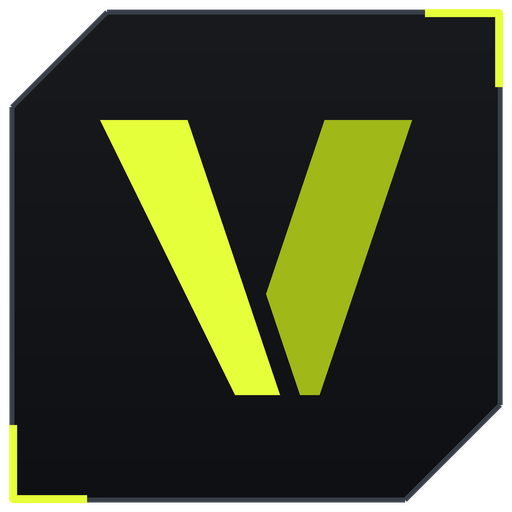
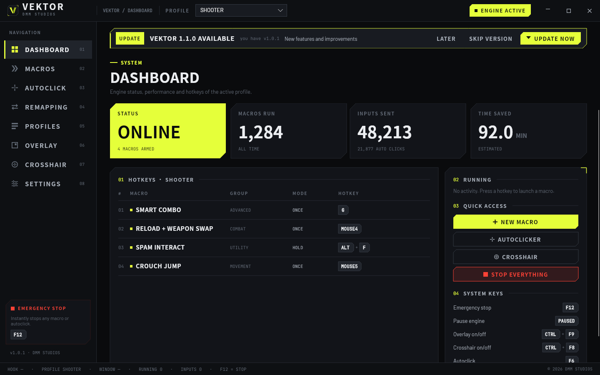
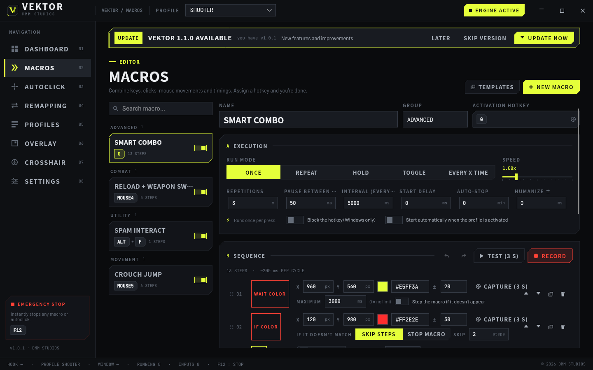
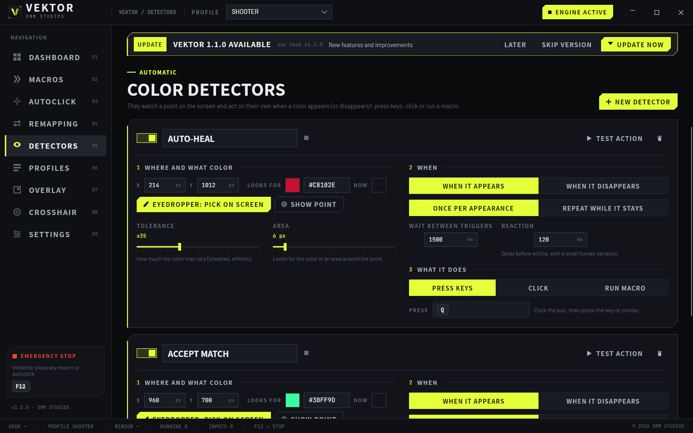
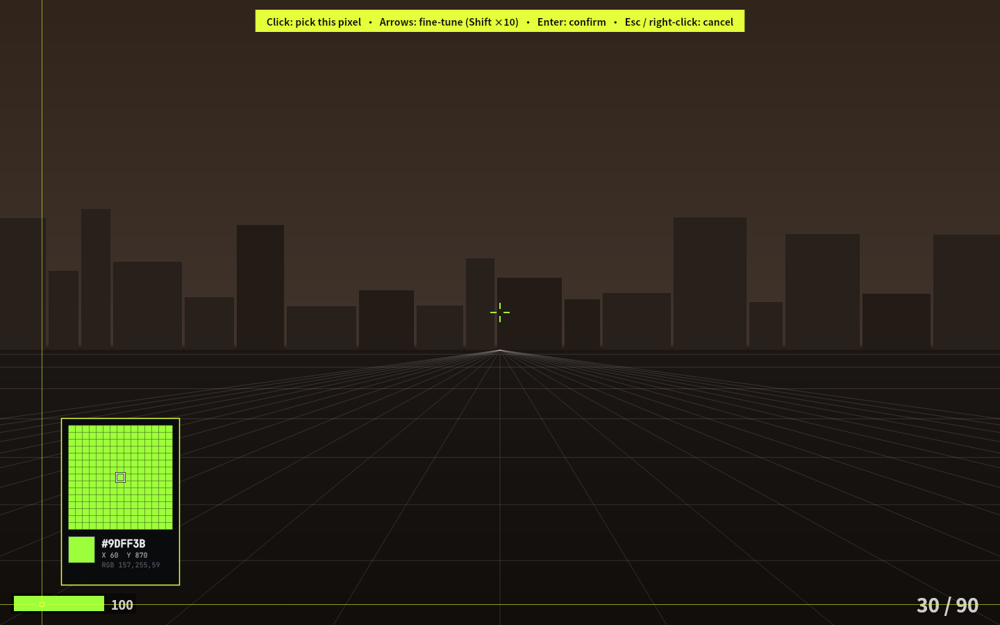
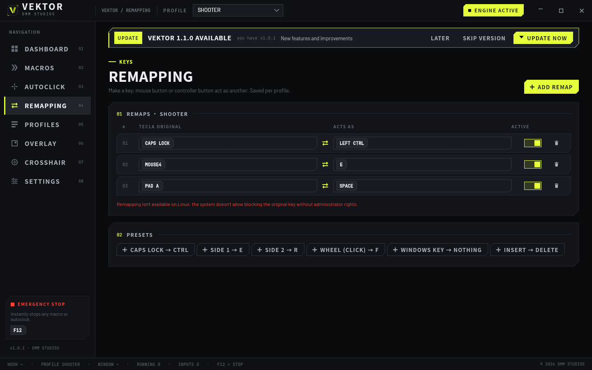
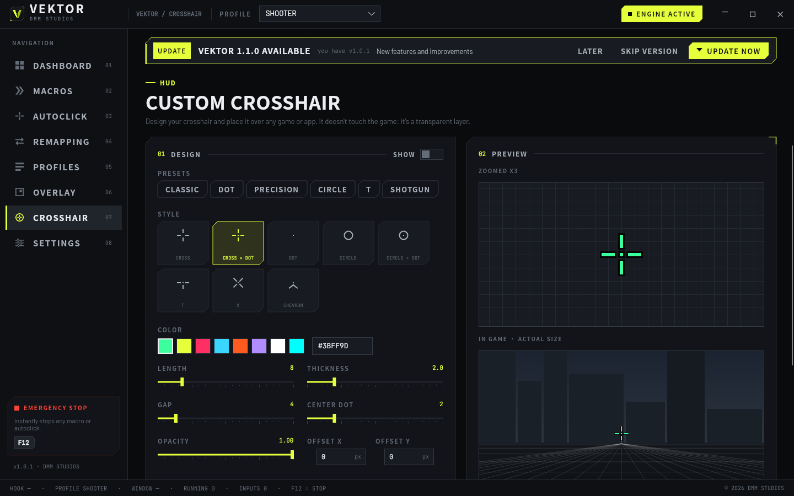
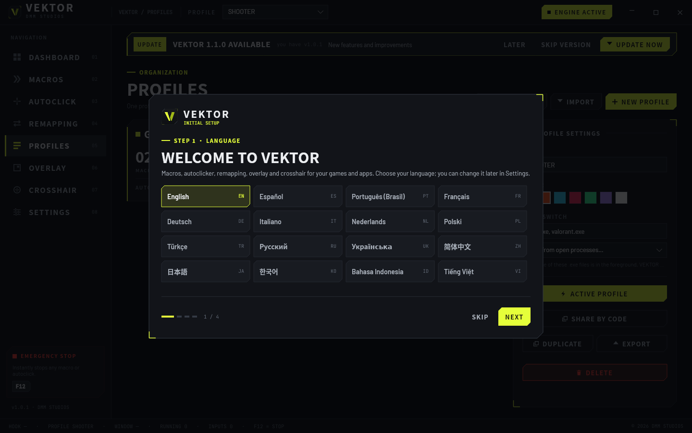

<p align="center"></p>

<h1 align="center">VEKTOR</h1>
<p align="center"><b>Motor de macros · Autoclicker · Remapeo · Overlay · Mira personalizada</b><br>Windows 10 / 11 y Linux · 64 bits · 16 idiomas · por DMM Studios</p>

<p align="center"><b>Español</b> · <a href="README.md">English</a></p>

## ⬇ Descargar

| Sistema | Descarga directa | |
|---|---|---|
| **Windows 10 / 11** | **[VEKTOR-Setup-x64.exe](https://github.com/Adriiiiiiiiii/dmm_vektor-releases/releases/latest/download/VEKTOR-Setup-x64.exe)** | Instalador (recomendado) |
| Windows | [VEKTOR-Windows-Portable-x64.zip](https://github.com/Adriiiiiiiiii/dmm_vektor-releases/releases/latest/download/VEKTOR-Windows-Portable-x64.zip) | Portable, sin instalar |
| **Linux** (cualquier distro) | **[VEKTOR-x86_64.AppImage](https://github.com/Adriiiiiiiiii/dmm_vektor-releases/releases/latest/download/VEKTOR-x86_64.AppImage)** | AppImage (recomendado) |
| Ubuntu / Debian / Mint | [vektor_amd64.deb](https://github.com/Adriiiiiiiiii/dmm_vektor-releases/releases/latest/download/vektor_amd64.deb) | Paquete .deb |
| Fedora / openSUSE | [vektor.x86_64.rpm](https://github.com/Adriiiiiiiiii/dmm_vektor-releases/releases/latest/download/vektor.x86_64.rpm) | Paquete .rpm |
| Linux genérico | [vektor-linux-x64.tar.gz](https://github.com/Adriiiiiiiiii/dmm_vektor-releases/releases/latest/download/vektor-linux-x64.tar.gz) | Comprimido .tar.gz |

Todas las versiones y novedades: **[Releases](https://github.com/Adriiiiiiiiii/dmm_vektor-releases/releases)** · Verificación: `SHA256SUMS.txt`



## Instalación

**Windows:** ejecuta `VEKTOR-Setup-x64.exe`. Si aparece *"Windows protegió su PC"*, pulsa **Más información → Ejecutar de todas formas**.

**Linux:**
```bash
chmod +x VEKTOR-x86_64.AppImage && ./VEKTOR-x86_64.AppImage
```
También: `sudo apt install ./vektor_amd64.deb` · `sudo dnf install ./vektor.x86_64.rpm`. Requiere sesión X11, o Wayland con los juegos bajo XWayland (Steam/Proton, Wine).

VEKTOR **se actualiza solo**: cuando hay una versión nueva, aparece un aviso dentro de la app. Todas las actualizaciones van **firmadas por DMM Studios** y la app rechaza cualquier versión sin esa firma.

## Funciones

- **Macros** con teclas, combinaciones, texto, clics, movimientos de ratón (con curvas humanas), rueda y esperas
- **Modos:** una vez · repetir · mantener · alternar · **cada X tiempo**
- **Condiciones por color en pantalla**, **bloques** de repetición y al azar, y llamadas a otras macros
- **Deshacer/rehacer** y reordenar pasos arrastrando
- **Grabadora** con tiempos reales y plantillas listas para usar
- **Detectores de color**: vigilan un punto de la pantalla y pulsan teclas, hacen clic o lanzan una macro cuando un color aparece o desaparece
- **Cuentagotas** con lupa: congela la pantalla y elige el píxel y el color exactos
- **Remapeo de teclas y botones** por perfil, botones del **mando** como atajos
- **Autoclicker** de 1 a 50 CPS con variación humana
- **Perfiles** por juego que cambian solos, **compartibles por código**
- **Overlay HUD** y **mira personalizada** encima de cualquier juego o programa
- **16 idiomas** y **modular**: desactiva lo que no uses
- Parada de emergencia (F12), bandeja del sistema, arranque con el sistema








---

<sub>Única fuente oficial de descarga: este repositorio. Algunos juegos online prohíben macros en sus normas; úsalo con responsabilidad. © 2026 DMM Studios.</sub>
