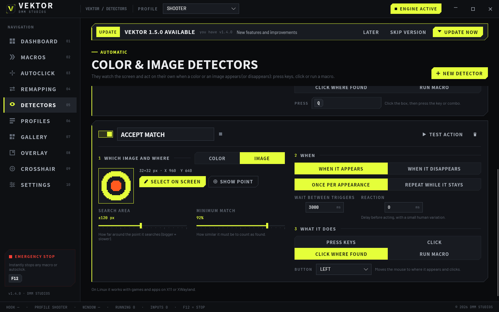
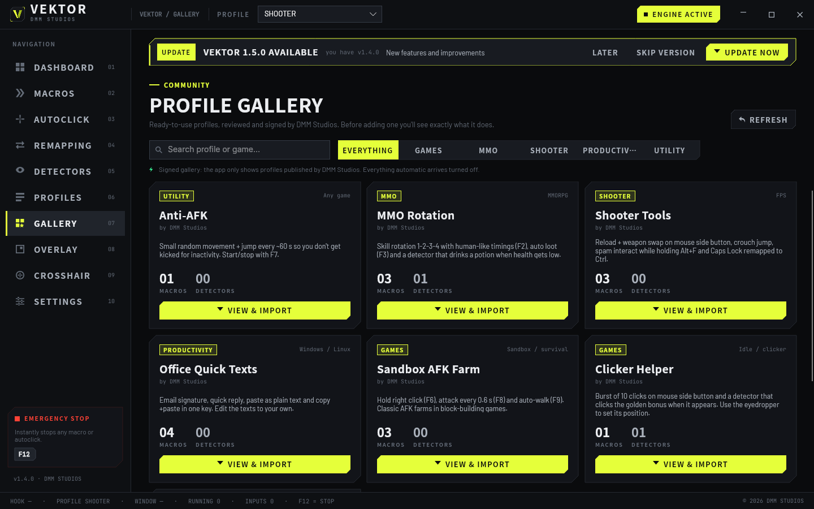

<p align="center"></p>

<h1 align="center">VEKTOR</h1>
<p align="center"><b>Macro engine · Autoclicker · Key remapping · Overlay · Custom crosshair</b><br>Windows 10 / 11 and Linux · 64-bit · 16 languages · by DMM Studios</p>

<p align="center"><a href="README.es.md">Español</a> · <b>English</b></p>

## ⬇ Download

| System | Direct download | |
|---|---|---|
| **Windows 10 / 11** | **[VEKTOR-Setup-x64.exe](https://github.com/Adriiiiiiiiii/dmm_vektor-releases/releases/latest/download/VEKTOR-Setup-x64.exe)** | Installer (recommended) |
| Windows | [VEKTOR-Windows-Portable-x64.zip](https://github.com/Adriiiiiiiiii/dmm_vektor-releases/releases/latest/download/VEKTOR-Windows-Portable-x64.zip) | Portable, no install |
| **Linux** (any distro) | **[VEKTOR-x86_64.AppImage](https://github.com/Adriiiiiiiiii/dmm_vektor-releases/releases/latest/download/VEKTOR-x86_64.AppImage)** | AppImage (recommended) |
| Ubuntu / Debian / Mint | [vektor_amd64.deb](https://github.com/Adriiiiiiiiii/dmm_vektor-releases/releases/latest/download/vektor_amd64.deb) | .deb package |
| Fedora / openSUSE | [vektor.x86_64.rpm](https://github.com/Adriiiiiiiiii/dmm_vektor-releases/releases/latest/download/vektor.x86_64.rpm) | .rpm package |
| Generic Linux | [vektor-linux-x64.tar.gz](https://github.com/Adriiiiiiiiii/dmm_vektor-releases/releases/latest/download/vektor-linux-x64.tar.gz) | .tar.gz archive |

All versions and changelogs: **[Releases](https://github.com/Adriiiiiiiiii/dmm_vektor-releases/releases)** · Integrity: `SHA256SUMS.txt`


## Install

**Windows:** run `VEKTOR-Setup-x64.exe`. If *"Windows protected your PC"* appears, click **More info → Run anyway**.

**Linux:**
```bash
chmod +x VEKTOR-x86_64.AppImage && ./VEKTOR-x86_64.AppImage
```
Also: `sudo apt install ./vektor_amd64.deb` · `sudo dnf install ./vektor.x86_64.rpm`. Requires an X11 session, or Wayland with games under XWayland (Steam/Proton, Wine).

VEKTOR **updates itself**: when a new version is out you get a notice inside the app. Every update is **signed by DMM Studios** and the app rejects any version without that signature.

## Features

- **Macros** with keys, combos, text, clicks, mouse moves (with human-like curves), wheel and waits
- **Run modes:** once · repeat · while held · toggle · **every X time**
- **Screen-color conditions**, repeat / random **blocks** and calling other macros
- **Undo/redo** and drag-and-drop step reordering
- **Recorder** with real timings and ready-made templates
- **Color detectors**: watch a point on screen and automatically press keys, click or run a macro when a color appears or disappears
- **Image detectors**: select an icon or button on screen and VEKTOR finds it (even if it moves) and clicks it or presses keys
- **Eyedropper** with magnifier: freeze the screen and pick the exact pixel and color
- **Community gallery** inside the app: ready-to-use profiles, signed by DMM Studios
- **Key & button remapping** per profile, **controller** buttons as hotkeys
- **Autoclicker** 1–50 CPS with human variation
- Per-game **profiles** that switch automatically, **shareable with a code**
- **Overlay HUD** and **custom crosshair** on top of any game or app
- **16 languages** and **modular**: turn off whatever you don't use
- Emergency stop (F12), tray icon, start with the system







---

<sub>Only official download source: this repository. Some online games forbid macros in their rules; use it responsibly. © 2026 DMM Studios.</sub>
